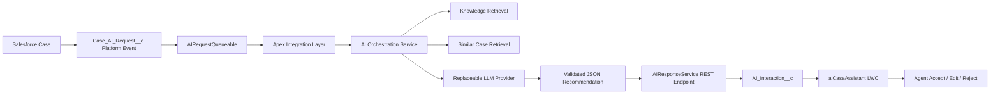

# Salesforce AI Case Copilot

AI-powered Service Cloud case resolution assistant built as an enterprise Salesforce integration, not a generic chatbot. The project demonstrates an asynchronous Case analysis pattern using Platform Events, Queueable Apex, a replaceable AI orchestration service, retrieval-augmented context, structured recommendations, and a Lightning Web Component where the Service Cloud agent remains the final decision maker.

## Business Problem

Service agents often spend time summarizing long case histories, searching Knowledge, finding similar resolved cases, and drafting careful customer responses. This copilot shortens that work while preserving human approval, auditability, and Salesforce security boundaries.

## Architecture



## Technologies

- Salesforce DX metadata
- Apex services, Queueable Apex, Platform Events, Named Credentials, REST resources
- Lightning Web Components
- Node.js AI orchestration service with a mock provider
- Structured JSON recommendation validation
- GitHub Actions for Salesforce metadata checks, AI service tests, and linting

## Repository Layout

```text
force-app/              Salesforce metadata, Apex, LWC, permissions
ai-service/             Replaceable AI/RAG service with mock LLM provider
docs/                   Architecture, security, AI design, demo scenarios
scripts/                Local validation helpers
data/                   Synthetic demo payloads
.github/workflows/      CI definitions
```

## Demo Workflow

1. Agent opens a banking Service Cloud Case: a customer made a credit-card payment but available credit has not updated.
2. Agent clicks **Analyze Case** in `aiCaseAssistant`.
3. Salesforce publishes `Case_AI_Request__e`.
4. `AIRequestQueueable` calls the AI service through the `AI_Case_Copilot` Named Credential.
5. The AI service retrieves synthetic Knowledge and similar resolved cases, constructs a guarded prompt, calls the mock provider, validates JSON, and returns a structured recommendation.
6. `AIResponseService` persists the result in `AI_Interaction__c`.
7. The LWC shows summary, category, evidence, recommended steps, draft response, confidence, and status.
8. Agent accepts, edits, or rejects. The Case is never closed automatically.

## Local AI Service

```bash
cd ai-service
npm test
npm start
```

The service runs with a mock provider by default and requires no paid API credentials.

```bash
curl -X POST http://localhost:3000/analyze \
  -H "content-type: application/json" \
  -d @../data/banking-payment-delay-case.json
```

## Salesforce Setup

1. Install Salesforce CLI.
2. Authenticate to a sandbox or scratch org.
3. Deploy metadata:

   ```bash
   sf project deploy start --source-dir force-app
   ```

4. Assign permission set:

   ```bash
   sf org assign permset --name AI_Case_Copilot_User
   ```

5. Configure Named Credential `AI_Case_Copilot` to point to the deployed AI service.
6. Add `aiCaseAssistant` to the Case Lightning record page.

## Testing

```bash
npm --prefix ai-service test
pwsh scripts/validate-project.ps1
sf apex run test --test-level RunLocalTests --result-format human
```

CI does not require production credentials. Salesforce deployment validation runs only when repository secrets for a target org are present.

## Security Model

- Apex reads use `WITH USER_MODE` where practical.
- DML sanitizes with `Security.stripInaccessible`.
- Permission set grants least-privilege access to the custom object and fields.
- No secrets are committed.
- External calls use Named Credentials.
- Prompt-injection defenses are applied before LLM calls.
- Structured output is validated before Salesforce persistence.
- Agent approval is required for all customer-facing actions.

See [docs/security.md](docs/security.md) for details.

## Screenshots

Screenshots are intentionally placeholders until deployed into a Salesforce org:

- Case record page with AI Case Assistant
- Processing state after Analyze Case
- Recommendation panel with Knowledge and similar Case evidence
- Agent edit/accept/reject flow

## Roadmap

- Add vector database backed retrieval.
- Add Einstein Trust Layer or preferred enterprise LLM provider.
- Add Salesforce Flow/Agentforce action wrappers.
- Add event replay and dead-letter handling.
- Add richer telemetry dashboards.

## License

MIT
