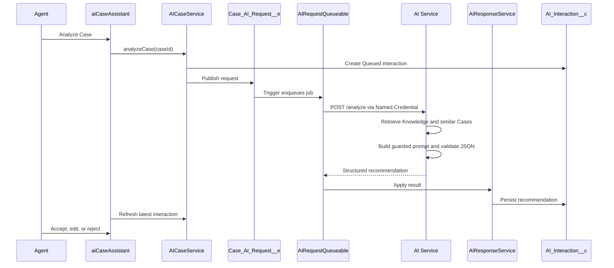

# Architecture

## Overview

Salesforce AI Case Copilot uses asynchronous Salesforce patterns so the Case page stays responsive and the AI provider is replaceable.



## Salesforce Layer

- `AICaseService` exposes LWC methods for analysis and agent decisions.
- `Case_AI_Request__e` decouples the button click from callout processing.
- `CaseAIRequestTrigger` enqueues `AIRequestQueueable`.
- `AIOrchestrator` owns outbound request construction and callout transport.
- `KnowledgeRetriever` and `SimilarCaseService` are intentionally modular so they can later use Knowledge, Data Cloud, vector search, or external search.
- `AIResponseService` supports both synchronous Queueable result persistence and a REST callback pattern.
- `AI_Interaction__c` is the durable audit record for status, model, latency, response JSON, confidence, agent decision, feedback, and errors.

## AI Service

The `ai-service` folder is a provider-neutral Node.js service. The default provider is a deterministic mock provider for demos and CI. A production provider can be added behind the same `generateRecommendation(prompt)` interface.

## Response Contract

The service returns structured JSON:

```json
{
  "summary": "...",
  "category": "...",
  "recommendedActions": [],
  "recommendedResolution": "...",
  "draftCustomerResponse": "...",
  "knowledgeReferences": [],
  "similarCases": [],
  "confidence": 0.86,
  "reasoningSummary": "Concise evidence summary."
}
```

`reasoningSummary` is user-facing evidence only. Hidden chain-of-thought is neither requested nor stored.

## Scaling Notes

- Platform Events and Queueables prevent long-running UI transactions.
- Request IDs support idempotency and traceability.
- The AI provider boundary allows model replacement without changing LWC or Salesforce persistence.
- `AI_Interaction__c` supports reporting, quality review, and audit requirements.
